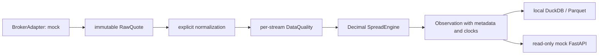

# Architecture — Phase 01

Analytics and frontend are future boundaries; they are not implemented. The API
materializes the packaged mock replay in memory at startup, independently of the
optional disk store. It has no live source, database write, authentication, arbitrary
file access, or broker configuration route. No service is started on module import.

## Module interfaces

| Module | Public interface | Side effects / contract |
|---|---|---|
| `models` | RawQuote, InstrumentMetadata, NormalizedQuote, DerivedSpread, Observation | frozen; extra fields rejected |
| `adapters.base` | BrokerAdapter.quotes() -> Iterator[RawQuote] | preserve acquisition order |
| `adapters.mock` | MockBrokerAdapter.quotes(), replay() -> tuple[Observation, ...] | hash-verified packaged synthetic JSON only; fresh state per replay |
| `normalization` | parse_price(text), normalize(raw, mapping, mapping_version=...) | pure; no time lookup or guessed mapping |
| `quality` | DataQuality(stale_after_ns=...).evaluate(quote, processing_time_ns=...) | sequential state per stream; no concurrency guarantee |
| `spread` | derive_spread(quote, metadata, flags) -> DerivedSpread | pure, explicit units, isolated Decimal context |
| `pipeline` | SpreadEngine(...).process(raw, metadata, processing_time_ns=...) | shared normalization/quality/metric path |
| `storage` | ObservationStore(path); append(), records(), export_parquet(), close() | local file creation only; context manager supported |
| `api` | create_app() -> FastAPI | synthetic records; GET only |
| `adapters.windows_contract` | WindowsSourceConfig, TickSnapshot, ReadOnlyTickPort, map_snapshot(...) | pure future port; no SDK binding, platform or connection call |
| `__main__` | replay [--output-dir PATH], serve [--port PORT] | explicit export or fixed-loopback server |

`ReadOnlyTickPort.symbol_info_tick(symbol)` returns a sanitized TickSnapshot or None.
Only a fake implementation exists. `map_snapshot` does not call that port. Future
bindings must be confined to Windows and a separate reviewed change.

## State and ordering

A quality engine belongs to one sequential replay/ingestion session. Stream keys
include source, broker alias, server alias, environment, raw symbol and ingestion
mode. Each stream stores its last signature and source/receive high-water marks;
there is no cross-stream comparison. Reset by constructing a new engine. Memory is
O(number of streams); dynamic unbounded source creation is outside Phase 01.
Never sort by a possibly regressing source clock before quality evaluation.

Storage assigns append ordinals and keys complete Observation JSON by SHA-256.
Identical records are idempotent; quotes with changed receive/processing clocks
remain separate. This is not a quote deduplication filter. `records()` preserves
first append order, including clock regressions. A single local writer is assumed.
No remote storage, telemetry, automatic uploads, retention policy, encryption or
migration framework is provided. Export refuses an existing destination.

## API

| Route | Result |
|---|---|
| GET /health | ok, MOCK_REPLAY, live_connectivity=NOT_TESTED |
| GET /v1/quotes?limit=1..100 | ordered mock Observations including raw provenance and quality flags |
| GET /v1/metadata | explicitly synthetic metadata |
| GET /openapi.json, /docs | schemas and interactive local documentation |

No POST/PUT/PATCH/DELETE data operations. Decimal JSON fields and nanosecond clocks
are strings. API limits are bounded; no CORS is enabled. TrustedHost rejects foreign
Host headers. The CLI uses 127.0.0.1 and disables access logs. Running arbitrary
uvicorn commands can override host behavior; use the supported CLI.
